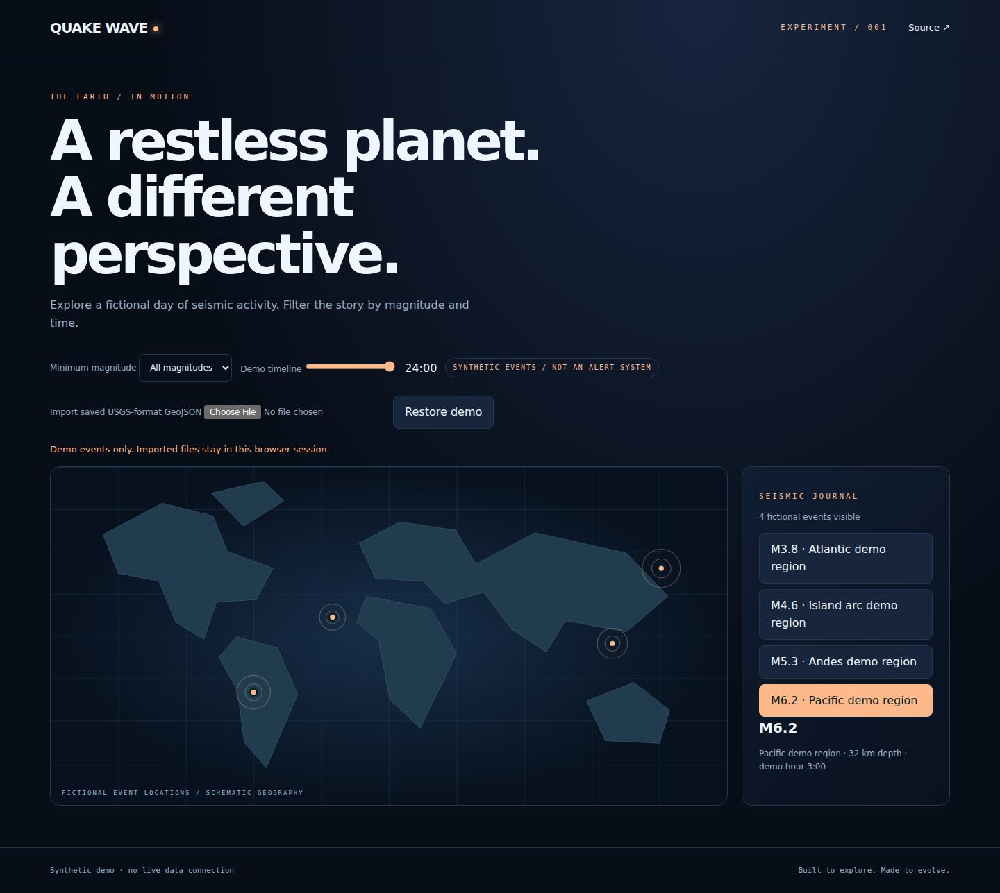

# Quake Wave

A seismic-storytelling demo with event selection, magnitude filtering and a scrubbed event timeline.

**Status:** working static prototype, no hosted deployment. See limitations below. This project uses no external assets, fonts, runtime dependencies, API keys or paid services.

## Quick start

Prerequisites: Python 3 for a local static server; Node.js 20+ for tests.

```bash
git clone https://github.com/manojPragada/quake-wave.git
cd quake-wave
python3 -m http.server 8000 --bind 127.0.0.1
```

Open http://127.0.0.1:8000. Keep the terminal running; Ctrl+C stops it. Serve over HTTP rather than opening index.html as a file because the app uses ES modules.

## Controls

Magnitude, timeline and maximum-depth filters compose, and the visible set can be ordered by time, magnitude or depth. Depth values in the bundled demo are fictional; imported values are shown exactly as supplied after numeric validation and are not independently verified.

Adjust minimum magnitude and timeline hour, then select a visible event to inspect magnitude, depth, coordinates and time. Imported records also show their source identifier when present; the app does not verify that provenance. **Play history** replays only the currently loaded static dataset from its earliest to latest time; it is disabled when reduced motion is requested and never represents a live feed or warning.

## Saved earthquake-file import

Use **Import saved USGS-format GeoJSON** to load a local FeatureCollection. The [USGS GeoJSON Summary format](https://earthquake.usgs.gov/earthquakes/feed/v1.0/geojson.php) defines magnitude, epoch-millisecond event times and Point coordinates `[longitude, latitude, depth]`. This importer accepts that subset; it does not fetch or authenticate the source. A compatible shape does not prove that a file contains real observations.

Files stay in memory and are not uploaded or persisted. Limits: 1 MiB and 5,000 features. Malformed collections or imports without valid records fail without replacing the current dataset; invalid individual records are skipped and counted. Imported labels show UTC event time and optional file-generation time, and never claim a live connection. Restore demo discards the imported dataset. `examples/usgs-shaped-demo.geojson` is explicitly synthetic test data, not an observation feed.

## Project structure

```text
index.html         semantic document and conventional navigation
src/style.css      visual design, responsive and reduced-motion rules
src/app.js         DOM wiring and interaction lifecycle
src/model.js       pure state/data helpers
tests/            Node behavioral tests (directory:tests/)
ROADMAP.md         completed work and next priorities
.env.example       configuration notes
```

## Architecture and configuration

Vanilla ES modules keep the initial product runnable without a package install. The UI and pure model logic are separated. Relative asset URLs support hosting from a repository subdirectory. There are no environment variables or secrets; .env.example records this intentionally empty configuration contract.

## Verification



Preview: local synthetic/offline prototype, captured 2026-10-20; not a live service.

Browser regression checks (development only; Node.js 24 and npm):

```bash
npm ci --ignore-scripts
npx playwright install --with-deps chromium
npm test
npm run check
npm run test:browser
```

The browser runner manages its own loopback server and checks desktop (1440px), mobile (390px), keyboard skip navigation, horizontal overflow, page errors, reduced motion and core interactions. Screenshots go to ignored test-results/. Optional CHROMIUM_EXECUTABLE_PATH selects an existing Chromium; PLAYWRIGHT_MODULE_PATH selects an installed Playwright module. The CI workflow skips private repositories. This is focused regression coverage, not a comprehensive accessibility audit or live-provider verification. The static app still requires no package installation.

```bash
npm test
npm run check
```

Node's built-in test runner checks model behavior. The check script validates JavaScript syntax; it is not a linter or a browser accessibility audit. No production build step is needed. Desktop/mobile browser checks, if completed, are recorded in ROADMAP.md; do not infer browser coverage from unit tests alone.

## Accessibility and performance

Semantic controls, visible keyboard focus, a skip link, responsive layouts and reduced-motion CSS are included. Decorative motion is pausable where present. No autoplay audio, analytics or external font requests. Browser-based interfaces require JavaScript except for the portfolio's conventional project links. An automated accessibility audit has not been completed.

## Data, assets and limitations

Bundled events are synthetic; imported files are user-supplied records whose provenance is not verified. The map is schematic. There is no earthquake feed, early-warning capability or safety advice. Never use this demo for emergency decisions.

All graphics and synthetic fixtures are original code in this repository. No third-party geographic dataset or media assets are bundled. No external API terms are relied upon in this prototype. Provider adapters will be documented and attributed before use.

## Deployment

The repository root is a static site. To publish on a static host, serve index.html with src/ at the same relative location and JavaScript files with an appropriate MIME type. No deployment has been performed or configured. Verify browser controls and data labels after deployment; do not add secrets to client code.

## Troubleshooting

- Blank page: use the HTTP server above, check browser console and confirm src/ is present.
- Port in use: select a different port, such as 8001.
- Tests unavailable: install Node.js 20+; there is no npm install step.
- Animation absent: check reduced-motion preferences and the pause control.
- Radio playback fails: use a direct playable HTTPS audio URL, not a webpage; network or codec support may prevent playback.

## Contributing

Use small, reviewable changes with a clear user benefit. Add model tests when behavior changes, run both verification commands, inspect desktop and mobile layouts, and update the roadmap and README. Use synthetic fixtures, preserve reduced-motion behavior and never commit secrets.

## License

A redistribution license has not yet been selected. Public visibility alone does not grant an open-source license.


